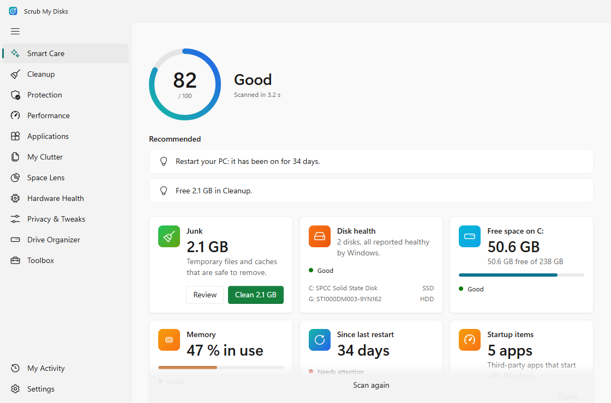

# Scrub My Disks (SMD)

[English](README.md)

Une application d'entretien gratuite et open source pour Windows 10 et 11. Elle réunit les meilleurs outils gratuits de santé du PC, avec une analyse guidée et sereine et les matières de Windows 11 (Mica, Segoe UI Variable, icônes Fluent).



> **Version 0.1.0**, la première version. Tous les modules fonctionnent. Téléchargez-la depuis les [Releases](https://github.com/Neverint/smd/releases).

## Principes de sécurité

1. **Regarder avant de toucher.** Chaque module analyse d'abord en lecture seule. Rien ne change avant que vous ayez examiné les résultats et cliqué sur le bouton d'action.
2. **Réversible par défaut.** Les fichiers vont dans la Corbeille (ou dans un dossier de quarantaine sur votre disque de secours). Les programmes au démarrage sont désactivés, pas supprimés. Chaque réglage peut être annulé. Un point de restauration système est créé avant toute modification du système.
3. **Moindre privilège.** L'application tourne sans droits administrateur. Quand une action en a besoin, Windows demande une fois, et un petit assistant ne fait que ce type d'action, choisi dans une liste fixe.
4. **Pas de poudre aux yeux.** Pas de nettoyeur de registre, pas de « booster de RAM », pas de faux gains de vitesse. Chaque chiffre est mesuré.
5. **Vie privée.** Pas de télémétrie, pas de compte. L'application ne se connecte que pour winget, les mises à jour et les téléchargements de la Boîte à outils, et vous le dit.
6. **Gratuit uniquement.** Chaque dépendance est gratuite et sous licence compatible. Voir [THIRD_PARTY_LICENSES.md](THIRD_PARTY_LICENSES.md).

## Modules

| Module | Rôle |
|---|---|
| Entretien express | Une analyse, une note de santé sur 100 et les meilleures corrections. Peut s'exécuter selon un planning (analyse seulement) |
| Nettoyage | Fichiers temporaires, caches, vidages mémoire, caches des navigateurs ; fichiers de Windows avec les droits administrateur |
| Carte de l'espace | Carte interactive de ce qui remplit un disque |
| Protection | État et analyses de Microsoft Defender, pare-feu, autorisations des applications |
| Performances | Programmes au démarrage (les vôtres et ceux de tous les utilisateurs), tâches planifiées, services, programmes en cours |
| Applications | Désinstallation propre avec examen des restes, mises à jour winget |
| Mes encombrants | Fichiers volumineux, anciens et en double |
| Santé du matériel | Capteurs en direct, santé des disques et détails SMART, batterie, mémoire |
| Confidentialité et réglages | Réglages réversibles de confidentialité, de publicité et d'applications intégrées, point de restauration d'abord |
| Organisation des disques | Chaque disque à sa place, déplacements sûrs, quarantaine sur un disque de secours |
| Boîte à outils | Installe et ouvre des outils spécialisés gratuits et fiables via winget |
| Mon activité | Historique des analyses et actions, avec annulation |

Une icône dans la zone de notification affiche un mini moniteur (processeur, mémoire, disque, réseau, espace libre) avec des actions rapides.

Les captures d'écran du [README anglais](README.md) utilisent des données d'exemple.

## Installer

1. Téléchargez le fichier qui se termine par `_x64-setup.exe` (ou le `.msi`) depuis les [Releases](https://github.com/Neverint/smd/releases).
2. Les installateurs ne sont pas encore signés : Windows SmartScreen peut afficher « Windows a protégé votre ordinateur ». Cliquez sur **Informations complémentaires**, puis **Exécuter quand même**. La signature via SignPath Foundation est prévue.
3. Les capteurs en direct de Santé du matériel demandent le [runtime .NET 8 Desktop](https://dotnet.microsoft.com/download/dotnet/8.0). Tout le reste fonctionne sans.

La désinstallation supprime aussi la tâche planifiée d'Entretien express. Vos réglages et votre historique restent dans `%LOCALAPPDATA%\io.github.neverint.smd` jusqu'à ce que vous supprimiez ce dossier.

## Compiler

Prérequis (Windows 10/11) : Node.js 24+, Rust (stable, MSVC), Visual Studio 2022 Build Tools avec la charge de travail **Développement Desktop en C++**, Microsoft Edge WebView2 (déjà présent sur Windows 11), SDK .NET 8 pour l'assistant capteurs.

```bash
npm install
npm run hwmon          # compiler l'assistant capteurs (une fois, puis après chaque modification de sidecars/hwmon)
npm run tauri dev      # lancer l'application
npm test               # tests unitaires
npm run e2e            # tests de fumée et d'accessibilité (Microsoft Edge)
npm run budget         # budget de taille au démarrage (docs/PERFORMANCE.md)
npm run tauri build    # installateurs NSIS + MSI
```

La suite est décrite dans [docs/ROADMAP.md](docs/ROADMAP.md) (en anglais).

## Licence

MIT, voir [LICENSE](LICENSE). Crédits : [THIRD_PARTY_LICENSES.md](THIRD_PARTY_LICENSES.md).
Inspiré de la disposition de CleanMyMac. Scrub My Disks n'est pas affilié à MacPaw et n'utilise aucun de ses éléments.
