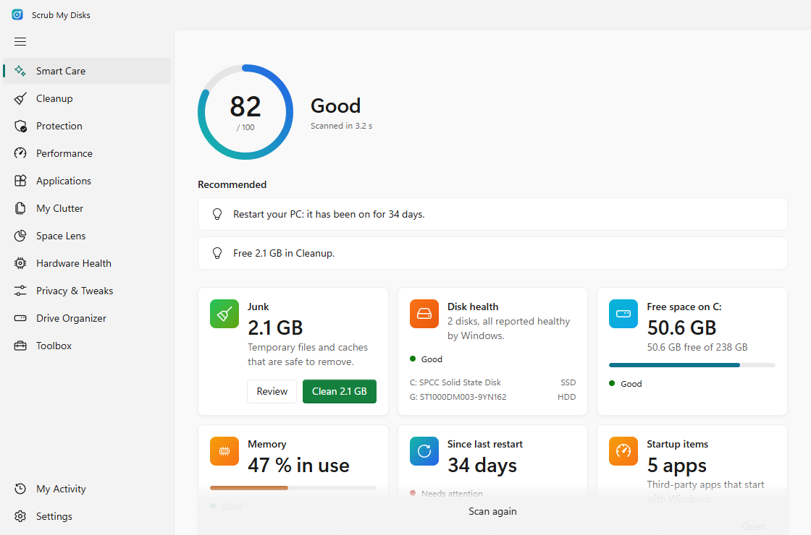
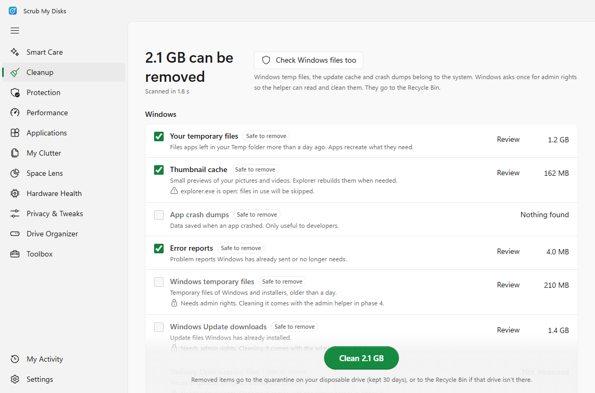
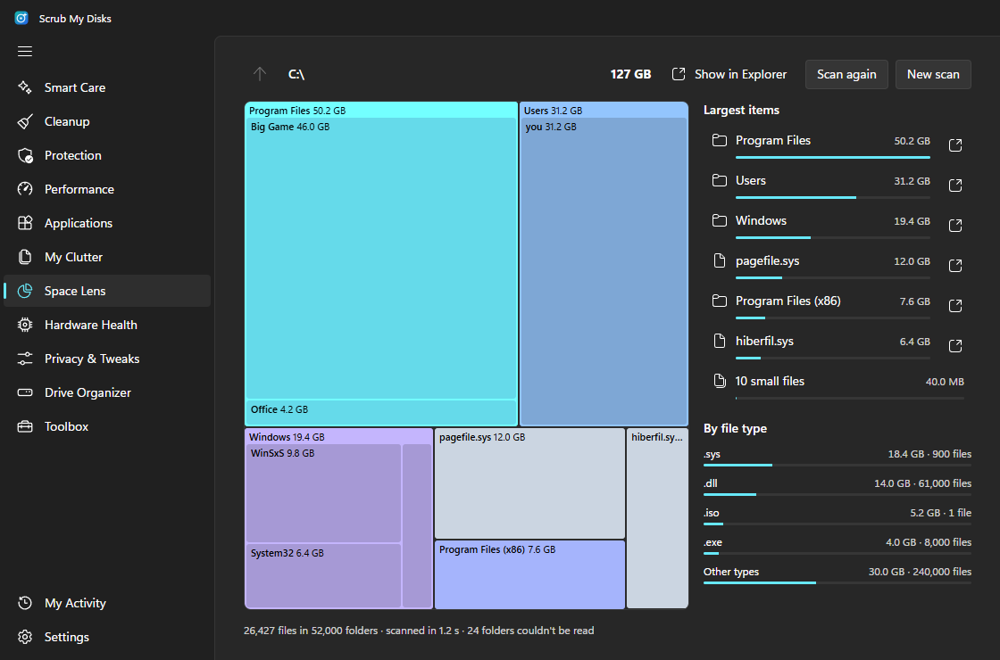
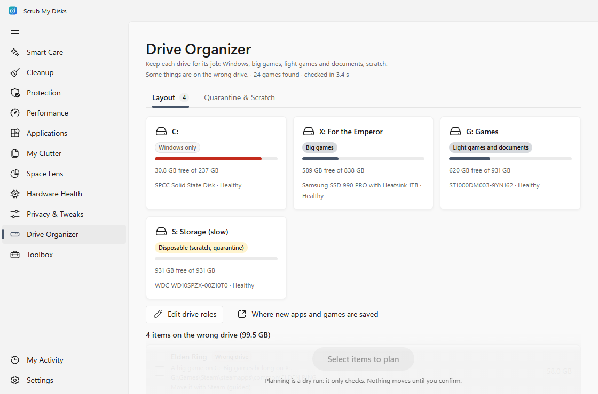
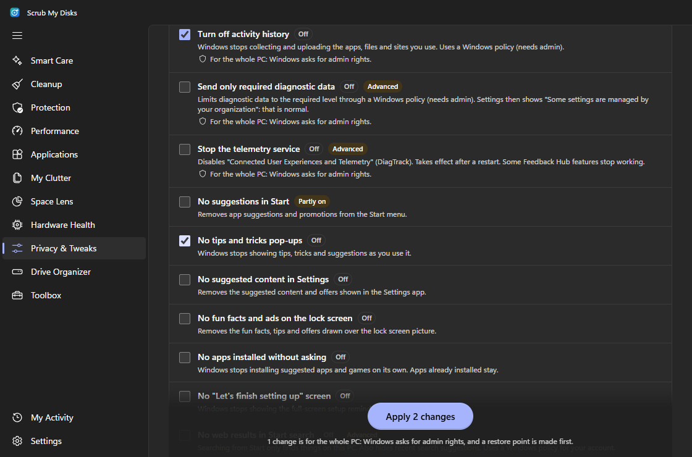
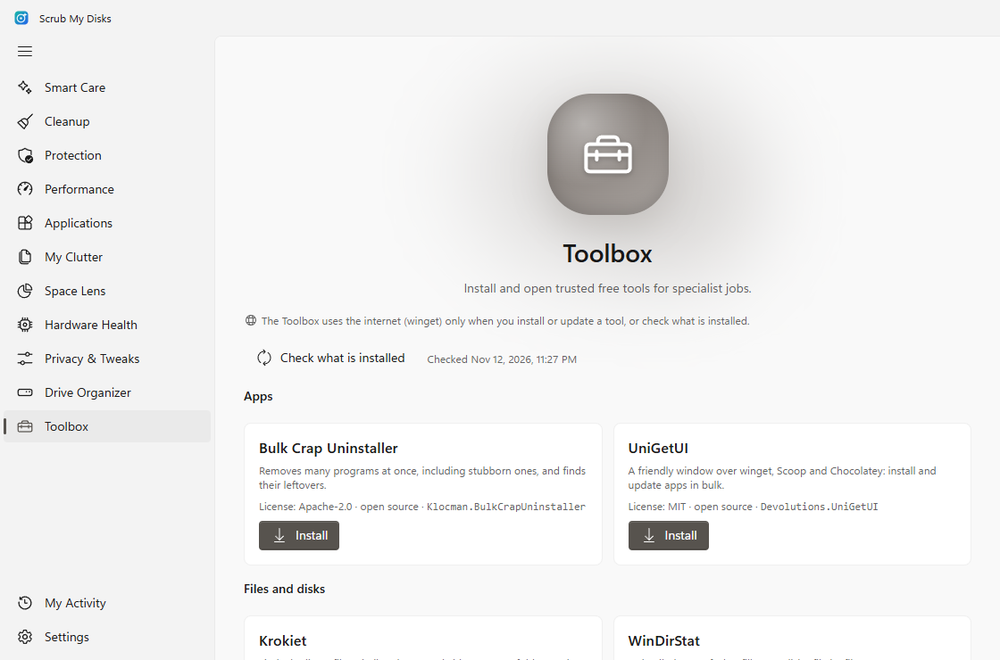
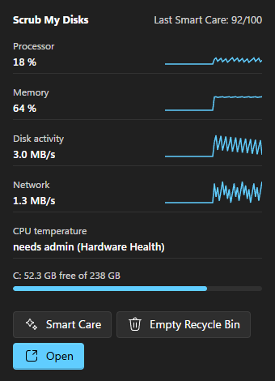

# Scrub My Disks (SMD)

[Français](README.fr.md)

A free, open-source maintenance app for Windows 10 and 11. It brings the best free PC-health tools together in one place, with a calm, guided scan flow and Windows 11 materials (Mica, Segoe UI Variable, Fluent icons).



> **Version 0.1.0**, the first release. Every module works. Download it from [Releases](https://github.com/Neverint/smd/releases).

## Safety principles

1. **Look before you touch.** Every module scans read-only first. Nothing changes until you review the results and click the action button.
2. **Reversible by default.** Files go to the Recycle Bin (or a quarantine folder on your spare drive). Startup items are disabled, not deleted. Every tweak has an undo. A System Restore point is created before system changes.
3. **Least privilege.** The app runs without admin rights. When an action needs them, Windows asks once and a small helper does only that kind of action, from a fixed list.
4. **No snake oil.** No registry cleaner, no "RAM booster", no fake speed-up numbers. Every number is measured.
5. **Privacy.** No telemetry, no account. The app only goes online for winget, updates and Toolbox downloads, and tells you when.
6. **Free only.** Every dependency is free and license-compatible. See [THIRD_PARTY_LICENSES.md](THIRD_PARTY_LICENSES.md).

## Modules

| Module | What it does |
|---|---|
| Smart Care | One scan, a health score out of 100, and the top fixes. Can run on a schedule (scan only) |
| Cleanup | Temporary files, caches, crash dumps, browser caches; Windows files with admin rights |
| Space Lens | Interactive map of what fills a drive |
| Protection | Microsoft Defender status and scans, firewall, app permissions |
| Performance | Startup apps (yours and all users'), scheduled tasks, services, programs running now |
| Applications | Clean uninstaller with a leftovers review, winget updates |
| My Clutter | Large, old and duplicate files |
| Hardware Health | Live sensors, drive health and SMART details, battery, memory |
| Privacy & Tweaks | Reversible privacy, ads and built-in app tweaks, restore point first |
| Drive Organizer | Keeps each drive for its job, moves things safely, quarantine on a spare drive |
| Toolbox | Installs and opens trusted free specialist tools through winget |
| My Activity | History of every scan and action, with undo |

A tray icon shows a mini monitor (processor, memory, disk, network, free space) with quick actions.

| | |
|---|---|
|  |  |
|  |  |
|  |  |

Screenshots use sample data.

## Install

1. Download the file ending in `_x64-setup.exe` (or the `.msi`) from [Releases](https://github.com/Neverint/smd/releases).
2. The installers are not code-signed yet, so Windows SmartScreen may say "Windows protected your PC". Click **More info**, then **Run anyway**. Signing through the SignPath Foundation is planned.
3. Hardware Health's live sensors need the [.NET 8 Desktop Runtime](https://dotnet.microsoft.com/download/dotnet/8.0). Everything else works without it.

Uninstalling also removes the scheduled Smart Care task. Your settings and history stay in `%LOCALAPPDATA%\io.github.neverint.smd` until you delete that folder.

## Build from source

Requirements (Windows 10/11):

- [Node.js](https://nodejs.org) 24 or later
- [Rust](https://rustup.rs) (stable, MSVC toolchain)
- Visual Studio 2022 Build Tools with the **Desktop development with C++** workload
- Microsoft Edge WebView2 (preinstalled on Windows 11)
- [.NET 8 SDK](https://dotnet.microsoft.com/download/dotnet/8.0) for the sensor helper

```bash
npm install
npm run hwmon          # build the sensor helper (once, and after changing sidecars/hwmon)
npm run tauri dev      # run the app
npm test               # unit tests
npm run e2e            # smoke and accessibility tests (uses Microsoft Edge)
npm run budget         # startup size budget (docs/PERFORMANCE.md)
npm run tauri build    # NSIS + MSI installers
```

Design choices are recorded in [docs/DECISIONS.md](docs/DECISIONS.md), performance budgets in [docs/PERFORMANCE.md](docs/PERFORMANCE.md), changes in [CHANGELOG.md](CHANGELOG.md).

## License

MIT, see [LICENSE](LICENSE). Third-party credits: [THIRD_PARTY_LICENSES.md](THIRD_PARTY_LICENSES.md).
Inspired by the layout of CleanMyMac. Scrub My Disks is not affiliated with MacPaw and uses none of its assets.
